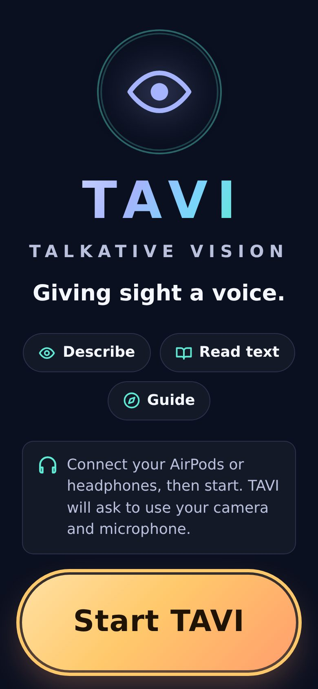
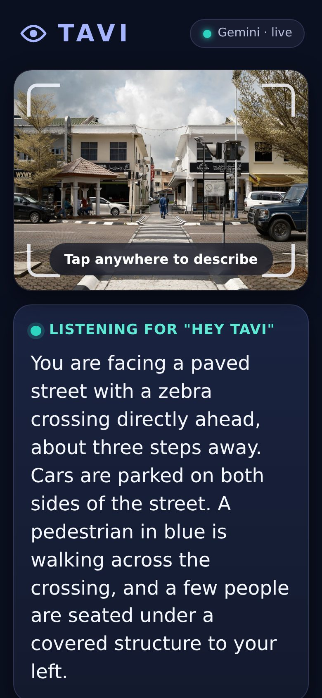
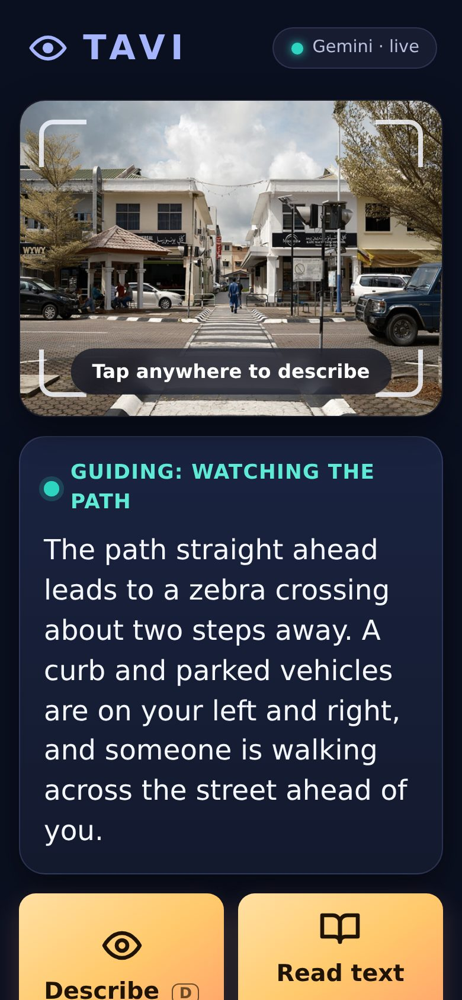
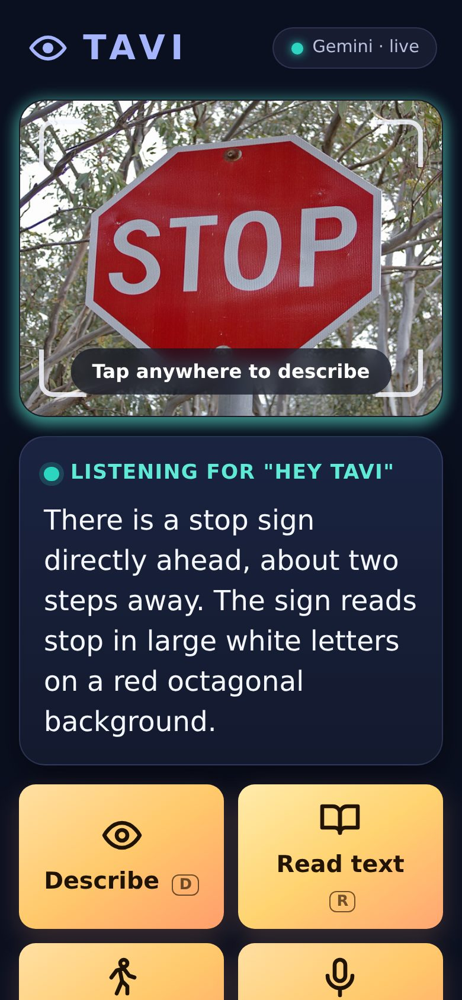
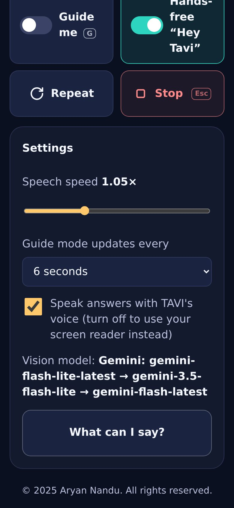
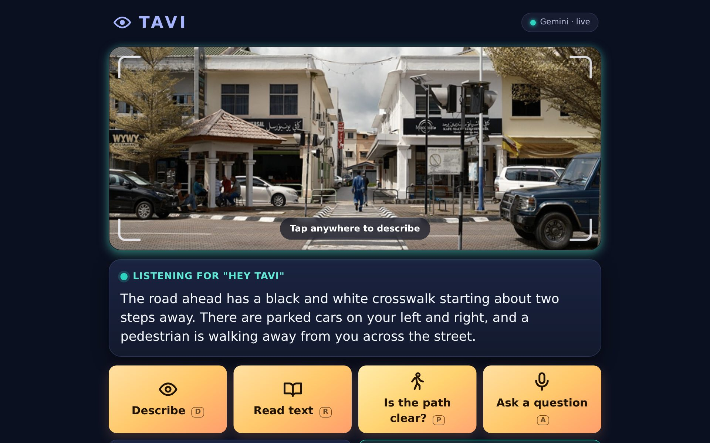

# TAVI – Talkative Vision

**Giving sight a voice.**

Created by **Aryan Nandu** · © 2025 Aryan Nandu. All rights reserved.

TAVI is a voice-first visual assistant for people who are blind or visually impaired. It uses a live camera to see what's around you, has a vision AI model sum it up in a sentence or two, and speaks the answer privately through your AirPods or any connected headset. Just say **"Hey Tavi"**.

This repository contains a working MVP: a mobile web app (PWA) that turns a phone, worn on a lanyard or chest mount, into the wearable, plus a small Node.js server that talks to the vision model.

## Screenshots

Live answers from Google Gemini, captured in the browser with a camera showing real photos.

<table>
  <tr>
    <td align="center" width="33%"><br><b>Start screen</b></td>
    <td align="center" width="33%"><br><b>Describe a scene</b></td>
    <td align="center" width="33%"><br><b>Guide mode</b></td>
  </tr>
  <tr>
    <td align="center"><br><b>Read text</b></td>
    <td align="center"><br><b>Settings</b></td>
    <td align="center"><br><b>Desktop / tablet</b></td>
  </tr>
</table>

## Features

| | |
| --- | --- |
| **Hands-free wake word** | Say "Hey Tavi" followed by a question, or say "Hey Tavi" alone, wait for the chime, then ask. |
| **Describe** | "What's in front of me?" / "Where am I?" gives a short scene summary, hazards first. |
| **Read text** | "Read this" reads signs, labels, menus, documents and screens. |
| **Path check** | "Is the path clear?" reports obstacles, steps and doors, with directions and distances. |
| **Guide mode** | "Guide me" checks the path every few seconds and speaks only when something changes. "Stop guiding" ends it. |
| **Ask anything** | "What colour is this shirt?", "Is the light green?", "How much is this?" Follow-up questions use recent conversation as context. |
| **Accessible by design** | Huge high-contrast buttons on a calm midnight, amber and teal palette, screen-reader labels, an option to answer through your screen reader instead of TAVI's voice, audio and haptic cues, keyboard shortcuts, reduced-motion support. |
| **Always know the status** | A status pill shows whether TAVI is live, in demo mode or offline; Settings shows the exact vision models in use. A warning plays if the camera is covered or it's too dark. |
| **Private** | Audio goes only to your headset. Frames are sent to the vision API only when you ask (or while Guide mode is on) and are never stored. |

### Voice commands

| Say | Does |
| --- | --- |
| "Hey Tavi, what's in front of me?" | Describe the scene |
| "Hey Tavi, read this" | Read visible text |
| "Hey Tavi, is the path clear?" | Check for obstacles |
| "Hey Tavi, guide me" / "stop guiding" | Toggle continuous guidance |
| "Hey Tavi, repeat" | Repeat the last answer |
| "Hey Tavi, stop" | Stop talking or cancel |
| "Hey Tavi, help" | List commands |
| "Hey Tavi, \<any question\>" | Free-form question about the scene |

Keyboard (desktop): `D` describe · `R` read · `P` path · `A` ask · `G` guide · `Esc` stop.

## Architecture

```
 Phone (PWA)                                   TAVI server (Node/Express)         Vision model
┌───────────────────────────────┐   frame +   ┌──────────────────────────┐      ┌──────────────┐
│ Camera ─► frame capture       │  mode/query │ /api/describe            │ ───► │ OpenAI       │
│ Mic ─► SpeechRecognition      │ ──────────► │  validation, rate limit, │      │ Gemini       │
│        └► "Hey Tavi" parser   │             │  timeouts, blind-first   │ ◄─── │ Anthropic    │
│ TTS + earcons ─► AirPods      │ ◄────────── │  prompt engineering      │      │ (or mock)    │
└───────────────────────────────┘ short reply └──────────────────────────┘      └──────────────┘
```

- `client/`: Vite + TypeScript PWA with no framework. Wake-word parsing and command classification live in `client/src/commands.ts`, camera capture and low-light detection in `camera.ts`, speech in and out in `speech.ts`.
- `server/`: Express + TypeScript. Prompts are in `server/src/prompts.ts`. Each provider is a small `fetch`-based adapter in `server/src/providers/`. API keys never reach the browser.

## Getting started

Requires Node.js 20+.

```bash
npm install
cp .env.example .env      # add one API key (OpenAI, Gemini or Anthropic)
npm run dev               # server on :8787, app on http://localhost:5173
```

Production:

```bash
npm run build
npm start                 # serves the app and API on http://localhost:8787
```

With no API key, TAVI runs in **demo mode**: the whole flow works, but answers are placeholders.

### Configuration (`.env`)

| Variable | Default | |
| --- | --- | --- |
| `TAVI_PROVIDER` | first key found, else `mock` | `openai`, `gemini`, `anthropic`, or `mock` |
| `OPENAI_API_KEY` / `OPENAI_MODEL` | `gpt-4o-mini` | |
| `GEMINI_API_KEY` / `GEMINI_MODEL` | `gemini-flash-lite-latest,gemini-3.5-flash-lite,gemini-flash-latest` | |
| `ANTHROPIC_API_KEY` / `ANTHROPIC_MODEL` | `claude-3-5-sonnet-latest` | |
| `PORT` | `8787` | |
| `TAVI_RATE_LIMIT_PER_MINUTE` | `30` | Per client IP |
| `TAVI_REQUEST_TIMEOUT_MS` | `20000` | Split across fallback models |

Each `*_MODEL` variable accepts a comma-separated list. The first model is used, and the next one is tried automatically if it is overloaded (429/5xx), retired (404), or too slow. Provider model names change often, so if you see 404s in the server log, point the variable at a current model.

### Using it on a phone

Browsers only allow camera and mic access over **HTTPS** (or on `localhost`). To try it on a phone, deploy the server somewhere with HTTPS (Render, Fly.io, Railway, etc.) or tunnel to it (`cloudflared tunnel --url http://localhost:8787`, `ngrok http 8787`). Open the URL, connect your AirPods, tap **Start TAVI**, and allow camera and microphone. "Add to Home Screen" installs it as an app.

Browser support: hands-free voice uses the Web Speech API, which works in Chrome (Android/desktop) and Safari (iOS 14.5+). Where it isn't available, every action is still reachable with the big buttons.

## Development

```bash
npm test          # unit + API tests (vitest)
npm run lint
npm run typecheck
```

## Roadmap ideas

- Dedicated wearable camera (ESP32-CAM or smart glasses) streaming to the same API
- On-device wake word (e.g. Porcupine) and offline obstacle detection for lower latency
- Natural neural TTS voices, multilingual support
- Remembering faces and places only with explicit consent, saved landmarks, and a "find my …" object search
- Native iOS/Android apps with background audio

## License

© 2025 Aryan Nandu. All rights reserved. See [LICENSE](LICENSE).
